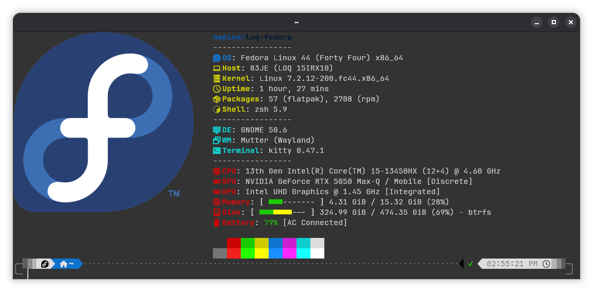
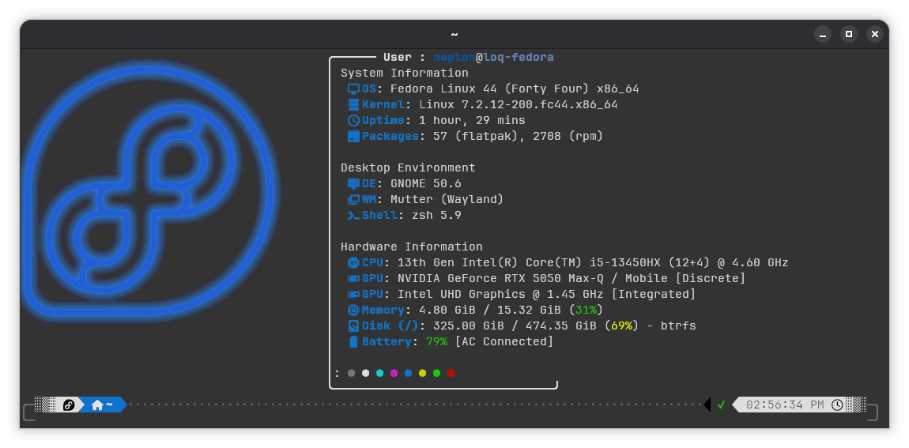

# My Linux config files

```
.
├── config
│   ├── btop
│   ├── cava
│   ├── fastfetch
│   │   ├── config1
│   │   └── config2
│   ├── ghostty
│   ├── kitty
│   └── Pinta
└── shell
```

## Fastfetch

>[!NOTE]
>To use those config you need a terminal that can display image. (Gnome Terminal does not support).

### Config 1


### Config 2


Last update: 31/10/2026
